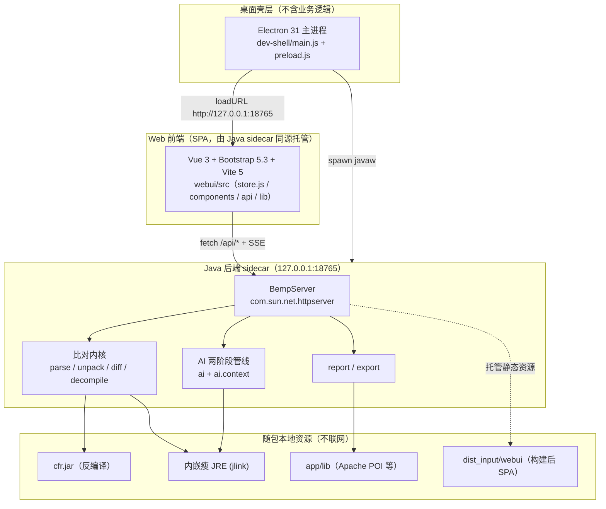
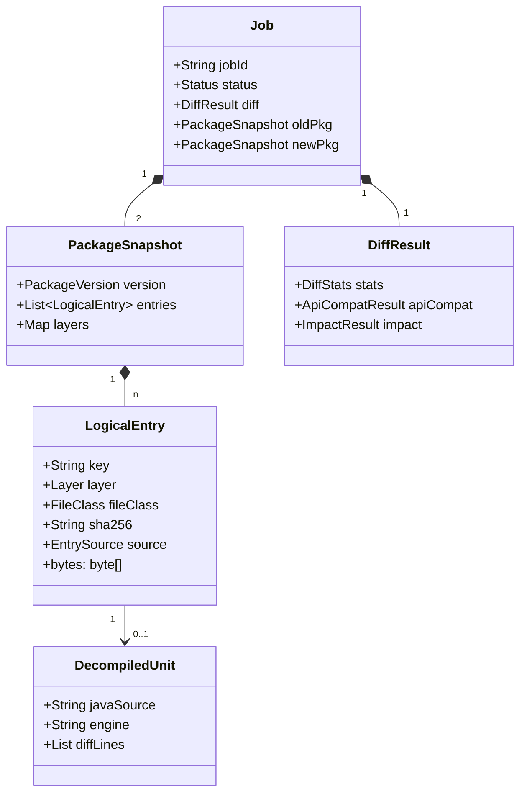
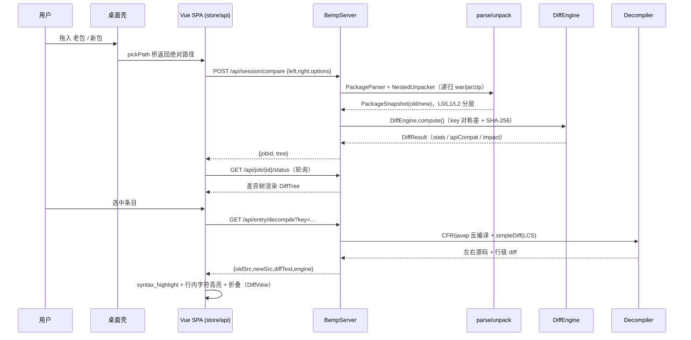
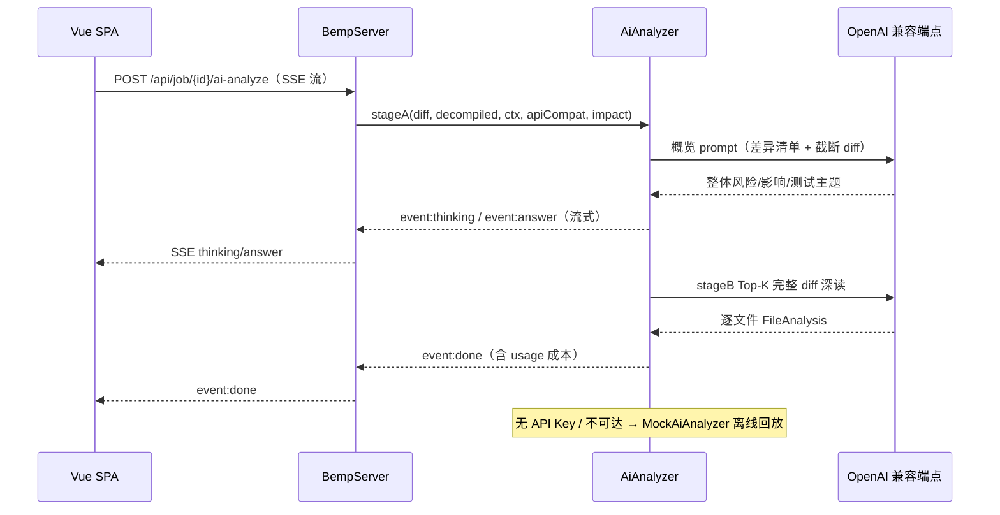
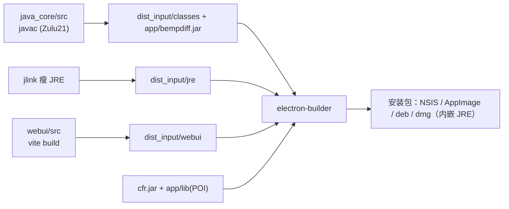
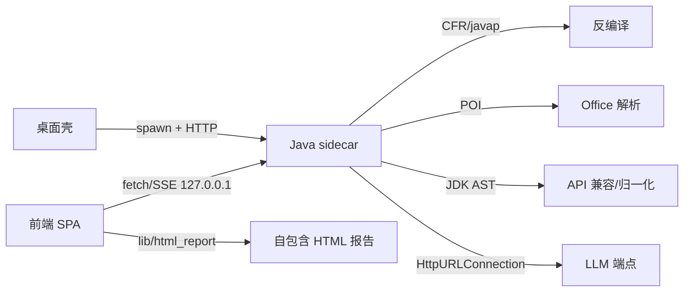

# BempDiff 系统架构设计文档

> 版本：基于工作区代码现状（commit 区间 `0.1.2026110101` 前后）编写
> 2026-11-02 更新：Tauri「路径 B」备选桌面壳已剔除（T04092），桌面壳仅保留 Electron；构建输入装配脚本更名为 `scripts/build_dist_input.ps1`。
> 编写依据：源码静态分析（`bempdiff/` 下 `webui/`、`dev-shell/`、`java_core/` 及根级 `package.json`/`sonar-project.properties` 等），所有描述均可在代码中找到对应实现，未引入任何虚构组件。
> 文档定位：本项目**顶层系统架构**文档。更细的需求、接口契约、模块级设计见 `docs/` 下《需求规格说明书》《详细设计-接口契约》《详细设计-项目级上下文增强模块》等。

---

## 1. 引言与系统概述

### 1.1 业务背景与目标

BempDiff 是一款面向 **Java 交付物（war / jar / zip / 文件夹）** 的**桌面差异化对比与智能分析工具**。它解决的核心问题是：「生产版本 vs 下发（候选）版本」的发布前比对长期依赖人工解压 + 肉眼看目录 + 记事本看 diff，既慢又易漏。

工具把这件事变成一次拖拽：

1. **自动逐层解包**：嵌套 `war → jar → zip` 递归展开为原子条目；
2. **分层结构化差异**：`L0` 包级清单 → `L1` 内部业务类 → `L2` 第三方依赖，噪声默认折叠；
3. **源码级改动**：class 经 CFR 反编译后逐行 diff，并经 JDK AST 归一化消除格式噪声；
4. **AI 风险分析**（可选、可降级）：两阶段流水线产出整体风险概览与逐文件深读；
5. **导出与门禁**：Markdown / 自包含 HTML / CI JSON 报告 + 差异资产包；`ci` 子命令以退出码卡住流水线。

设计原则贯穿全程：**本地优先、离线可用、AI 不可达时自动降级**——比对 / 反编译 / 报告全链路不依赖外网；唯一的外呼是用户自行配置的 AI 服务商与 GitHub 发布检查。

### 1.2 三种同源运行形态

同一套 Java 内核以三种形态对外提供服务，**全部复用 `java_core` 的 `server` 与 CLI 入口**：

| 形态 | 入口 | 适用场景 |
|---|---|---|
| 桌面 GUI | Electron 壳拉起 Java sidecar，内嵌 WebView 加载同源 SPA | 日常比对、审阅、导出 |
| 命令行 headless | `com.bempdiff.Main <子命令>`（或打包后的 `BempDiff.exe`） | 服务器、脚本、无界面比对 |
| 本地 Web 服务 | `server --port 18765 --webroot <dir>` | 浏览器访问同一套界面（Linux / macOS 主要用法） |

### 1.3 与既有设计文档的关系

本文档是**架构总览**，下列文档是它之下的分解，互不矛盾：

- 需求层：`需求规格说明书-差异化对比工具.md`、`需求规格说明书-客户体验提升对标BeyondCompare.md`
- 设计层：`详细设计-接口契约-差异化对比工具.md`、`详细设计-二期M1-R1至R4.md`、`详细设计-项目级上下文增强模块.md`
- 专项：`WebUI迁移方案.md`（含"路径 B：Tauri 桌面壳"的历史评估，该路径已于 T04092 剔除）、`SECURITY-权限隔离评审.md`、`arm64平台评估.md`、`性能测试报告.md`

---

## 2. 总体架构

### 2.1 分层架构视图

系统由三层进程 + 一组随包本地资源构成。桌面壳仅做"窗口宿主 + 进程管理"，不含业务/反编译逻辑；所有比对能力收敛在 Java sidecar；前端 SPA 通过回环 HTTP 调用 sidecar 的 REST/SSE 接口。

### 2.2 关键架构决策

| 决策 | 选择 | 理由（代码佐证） |
|---|---|---|
| 桌面壳与内核解耦 | sidecar 独立进程 | `dev-shell/main.js` `spawn(java, ["...Main","server","--port",18765])` |
| 通信走回环 HTTP | `127.0.0.1` + 同源 SPA | 规避 CORS、复用浏览器 fetch；`BempServer` `HttpServer.create(new InetSocketAddress("127.0.0.1", port))` |
| HTTP 栈零三方依赖 | JDK `com.sun.net.httpserver` + `HttpURLConnection` | 源码无 Spark/OkHttp/Netty 依赖；JSON 为手写 `server/Json.java` |
| 反编译双通道 | CFR 进程内 API 优先，进程外 `java -jar` + `javap` 降级 | `Decompiler.cfrInProcess()` / `cfr()` / `javap()` |
| 离线优先 | AI 不可达走 Mock | `MockAiAnalyzer`；`--apikey ""` 强制本地 Mock |
| 无容器化 | 桌面安装包 + headless | 仓库无 Dockerfile / K8s 清单（见 §6.4） |

---

## 3. 模块详细设计

### 3.1 桌面壳层（进程管理 + 原生窗口 + 原生对话框）

**单一桌面壳**：Electron 是本项目的桌面壳（`bempdiff/package.json` 的 `electron-builder` 配置、`dev-shell/` 为主进程），只做「窗口宿主 + 进程管理」，不含业务逻辑；比对能力全部在 Java 后端。前端通过 `dev-shell/preload.js` 暴露的桥 `pickPath / openPath / showInFolder / downloadInstall` 使用原生能力，探测与降级逻辑集中在 `webui/src/lib/desktop-bridge.js`。

- `main.js`：
  - 自适应屏幕尺寸创建主窗口（避免被任务栏/屏外截断，含托盘常驻与"最小化到托盘/直接关闭"行为持久化）；
  - 静默启动 Java 后端：`spawn(javaBin, ["-Xmx2g","-cp",classPath,"com.bempdiff.Main","server","--port",18765])`，`windowsHide` 无控制台窗口；
  - 端口探测（`isPortOpen` / `waitPort`）保证后端就绪后再亮主窗；
  - 退出时回收子进程树（`taskkill /F /T`）并释放 18765 端口；
  - 崩溃诊断：未捕获异常/拒绝写入 `logs/shell.log`。
- `preload.js`：经 `contextBridge` 仅暴露受控 API（文件选择、打开/定位、更新下载、关闭行为、外部路径监听 `bempdiff:shell-compare`），不暴露 `ipcRenderer` 本身。
- `close-behavior.js`：关闭行为配置读写，含单测。

> 注：开发态 classpath 指向 `dist_input/classes`（`javac` 直编产物），打包态由 `scripts/build_dist_input.ps1` 装配为 `dist_input/app/bempdiff.jar`；两种形态的启动参数语义一致（`server --webroot <dir> --port 
`）。

### 3.2 Web 前端（`webui/`）

**技术**：Vue 3.5 + Bootstrap 5.3.3（以本地 vendor 资源 `/vendor/bootstrap.min.css`、`/vendor/bootstrap-icons.css` 随构建内联，**非 npm 运行时依赖**）+ Vite 5 + Vitest 2。运行时仅 `vue` 一个 npm 依赖。

**应用骨架（`App.vue`）**：上方 `ToolBar` → 中段 `app-main` 三栏（`DiffTree` 左、`DiffView` 中、`InfoPanel` 右，含可拖拽分隔条与专注模式）→ 底部 `StatusBar`；叠加 `ConfigDialog` / `ReportPreview` / `CostGateDialog` / `CompareOverlay` / `GuideOverlay` / `ShortcutHelp` / `DragDropOverlay` / 更新提示条。

**核心模块**（均位于 `webui/src`）：
- `store.js`：中央响应式状态仓库（基于 Vue reactivity，**非 Pinia**），承载比对会话、差异树、AI 任务、配置、主题/语言等全局状态；`init()` 在挂载时初始化并触发静默更新检查。
- `api/client.js`：对 `BempServer` REST 的极简 `fetch` 封装；`analyzeStream()` 消费 `/api/job/{id}/ai-analyze` 的 SSE 流（`event:/data:` 分发 `thinking/answer/done/error`），返回 `AbortController` 供"停止"；同源（生产经 sidecar 托管、dev 经 vite proxy）免 CORS。
- `components/`：约 25 个 `.vue`，覆盖工具栏、差异树、双栏/统一 diff 视图、信息面板、AI 控制台、报告预览、配置中心、下载管理、帮助/引导/快捷键等。
- `lib/`：纯函数工具集——`diff_inline`/`diff_align`/`diff_fold`/`diff_search`/`diff_select`（行内字符级高亮、对齐、折叠、搜索）、`syntax_highlight` + `hl_themes`（语法高亮与主题包）、`html_report`（自包含 HTML 报告生成，**前端侧职责**）、`i18n`（中英双语，含 11 万行级词条）、`tree_actions`/`dir_tree`（差异树操作与渲染）、`ignore`（忽略规则）、`severity`/`token_classify`（风险分级与着色）、`guide`/`shortcuts`/`accents`/`desktop-bridge`（Electron 桥探测 + 原生对话框）等。
- `styles/main.css`：主题感知样式（亮/暗/跟随系统 + 多套强调色 + Bootstrap 5.3 覆盖层）。

> 准确性说明：自包含 HTML 报告由**前端** `lib/html_report.js` 生成，Java 内核仅产出 Markdown 报告与 CI JSON（见 §3.3.5、§4.5）。

### 3.3 Java 后端 sidecar（`java_core/`）

源码根 `java_core/src/com/bempdiff/`，**无 Maven/Gradle 构建系统**，由 `scripts/_compile_to_dist.ps1`（或 `build_and_test.sh`）用 Zulu 21 `javac` 直编至 `dist_input/classes`，构建输入统一由 `scripts/build_dist_input.ps1` 装配（`bempdiff.jar` + 瘦 JRE + 前端镜像）。包结构如下：

| 包 | 关键类 | 职责 |
|---|---|---|
| `Main` | `Main` | CLI 入口与子命令分发（`dispatch` 经 `switch` 路由至 `compare/inspect/report/export/decompile/ai/server/ci/diff-jars/folderdiff/compare-folders`，共享 `prepCompare()` 样板） |
| `parse` | `PackageParser`、`FolderParser`、`PackageVersion` | 包类型识别、嵌套归档逐层展开、`L0/L1/L2` 分层判定、版本提取、按层取字节 |
| `unpack` | `NestedUnpacker`、`UnpackOptions`、`UnpackReport` | 多线程逐层物理平铺（war/jar/zip 递归），内存/磁盘双轨（单条目 ≤64KB 驻留、每作业 256MB、全局 3× 硬上限、超额落盘），Zip Slip 防御、深度/字节上限、deadline 屏障 |
| `model` | `LogicalEntry`、`PackageSnapshot`、`Layer`、`FileClass`、`PackageType`、`DecompiledUnit`、`EntrySource` | 逻辑条目 / 包快照 / 反编译产物 / 分层与文件分类枚举 |
| `diff` | `DiffEngine`、`ApiCompat`、`ImpactAnalyzer`、`LibJarDiff`、`FrontendTextDiff`、`OfficeTextDiff`、`AstNormalizer`、`FolderDiff`、`LineDiff`、`DiffDigest`、`ArchiveDiff` | 全量差异、API 兼容分级、影响面、差异 lib jar 内部对比、前端/Office 文本 diff、AST 归一化、行级 diff |
| `decompile` | `Decompiler` | CFR 进程内 API 优先 + 进程外 `java -jar cfr.jar` 降级 + `javap` 签名级降级；GBK 容错解码；LRU 内存+磁盘反编译缓存；自研 LCS 行级 diff |
| `ai` | `AiAnalyzer`、`HttpAiAnalyzer`、`MockAiAnalyzer`、`PromptBuilders`、`StageASummary`、`FileAnalysis`、`FileRisk`、`CategoryConclusion` | AI 两阶段分析接口、HTTP 实现、Mock 离线回放、prompt 构造与脱敏 |
| `ai.context` | `ProjectContextAnalyzer`、`ProjectContextService`、`ProjectContextCache`、`ProjectIndexer`、`ProjectIndex` | 项目级上下文离线扫描、索引、缓存与服务 |
| `config` | `ParseConfig`、`AiConfig`、`AiProfile(sStore)`、`AiVendorConfigStore`、`LlmPreset` | 分层策略 / AI 两阶段+成本闸门 / 供应商画像与预设 |
| `report` | `MarkdownReport`、`FolderReport`、`MarkdownParser` | Markdown 报告（双包/文件夹） |
| `export` | `AssetExporter` | 差异 class/jar、反编译源码 zip、增量/删除资产、zip 树打包 |
| `server` | `BempServer`、`ServerConfig`、`Job`、`JobStore`、`Json`、`LruMap`、`CompareOptions`、`DiagBundle`、`UpdateCheckService` | 内嵌 HTTP sidecar、配置持久化、作业状态、脱敏诊断包、更新检查 |
| `fs` / `util` | `FileOps`、`ShortHash`、`TextCodec` | 文件操作工具、短哈希（SHA-1 前 7 位）、文本编解码 |

#### 3.3.1 比对内核（`diff` + `parse` + `unpack`）
- **入口级差异**：`DiffEngine.compute()` 取两侧 key 并集，做"对称差 + SHA-256"比对——缺一侧=ADDED/DELETED，SHA 不等=MAGIFIED→MODIFIED；文本类文件先经规范化比较消除行尾/BOM/行尾空白噪声；`.java` 再叠加 AST 口径（见下）。
- **分层规则**（`PackageParser.layerForEntry`）：`L1` 业务代码（命中内部包前缀的普通 jar、war 的 `WEB-INF/classes`、`expandInternalLib` 开启时内部 lib jar 中业务类）；`L2` 第三方 `lib/*.jar`；`L0` 其余。统计区分 `bizChanged` 与 `jarChanged`。
- **递归解包**（`NestedUnpacker.flatten`）：固定线程池逐容器任务，用 `ZipFile` 递归下钻，原子文件写临时磁盘并平面化为 `容器key/内层路径` 键；带内存预算、字节上限、最大深度、Zip Slip 防御与 deadline 屏障（防止 AI 阶段在解包未完成前启动）。
- **行级源码 diff**：`Decompiler.simpleDiff()` 自研 LCS 行级 diff（不引入第三方库），配合 `DiffRules` 忽略规则；`DiffDigest` 渲染紧凑变更摘要供 prompt 消费。

#### 3.3.2 反编译与 AST 归一化（`decompile` + `diff.AstNormalizer`）
- **CFR 调用**：运行时若 `org.benf.cfr.reader.api.CfrDriver` 在 classpath 上，走**进程内**反编译（自建 `OutputSinkFactory` 捕获 `Decompiled.getJava()`，修复逐类冷启动问题）；否则降级为 `ProcessBuilder(javaBin,"-jar",cfrJar,...)`，stdout 经 GBK/UTF-8/latin-1 容错解码。
- **javap 降级**：CFR 缺失/失败时 `javap -p -c` 输出签名级反编译，引擎标记 `engine="javap"`。
- **AST 归一化（JDK `com.sun.source` / `javax.tools.JavacTask`）**：`AstNormalizer` 把 `.java` 解析为 AST 后按"成员种类 + 结构化打印"拼接，使格式化/注释/成员重排归一后相等，方法体实质变更仍不等；解析失败/超 2MB/无类型声明返回 `null`，调用方回退行级并计数（`degradedCount`）。

#### 3.3.3 API 兼容性分级与影响面（`diff.ApiCompat` / `diff.ImpactAnalyzer`）
- `ApiCompat` 用 `JavacTask` + `TreeScanner` 提取 public/protected 方法（参数+返回）与字段签名，分级：`REMOVED_API`（二进制不兼容）、`SIGNATURE_CHANGED`（同名参数/返回变化，二进制不兼容）、`ADDED_API`（兼容、信息性）；同方法跨版本参数变化从 removed/added 配对升级为 `SIGNATURE_CHANGED`。
- **行为变更**不靠静态分级覆盖，而由 `ImpactAnalyzer` 在反编译集内建"引用索引"输出影响面风险（CRITICAL：删除类仍有引用方；HIGH：签名变更且有引用方；MEDIUM：仅实现变更被引用；LOW：孤岛/纯新增）并提供引用证据链；真正的**语义/行为级变更**交由 AI 两阶段深化（`CategoryConclusion.breakingChanges`）。

#### 3.3.4 AI 两阶段管线（`ai` + `ai.context`）
- **接口与实现**：`AiAnalyzer` 两个实现——`HttpAiAnalyzer`（真实调用 OpenAI 兼容 `/v1/chat/completions`，用 `HttpURLConnection`，支持 OpenAI/Azure/Ollama/通义，含 TLS 阶梯、代理、SSRF 防护拒绝 `169.254.169.254`/私网）、`MockAiAnalyzer`（离线回放 / 无 Key 降级）。
- **阶段 A（概览）**：发"差异清单 + 每文件截断 diff 摘要"，产出整体风险/影响/测试主题 + 每文件初评。
- **阶段 B（Top-K 深读）**：仅对前 `stageBTopK` 候选（默认 15；按 `fileClass` 区分 Java/前端 JS/HTML/CSS/JSP/CONFIG 措辞）发完整 diff 深读，逐文件产 `FileAnalysis`。
- **成本闸门 / token 预估**：`estimateTokens = prompt.length()/2`；`costGateWarnTokens`（默认 8000）超阈值告警；阶段 B 仅深读 Top-K；`maxPromptTokens` 窗口护栏取消超窗请求；`STAGE_A_TOTAL_CHAR_CAP=60000` / `STAGE_A_FILE_CHAR_CAP=8000` / `STAGE_B_DIFF_CHAR_CAP=60000` 字符级护栏；响应 `usage` 段解析供审计。
- **项目级上下文**：`ProjectContextAnalyzer.analyze(Path)` 离线遍历（限 `MAX_FILES=4000`/`MAX_DEPTH=12`）识别构建系统/模块/依赖/入口/技术栈，经 `ProjectContextService/Cache/Indexer` 缓存。

#### 3.3.5 报告与导出（`report` + `export`）
- **Markdown 报告**：`MarkdownReport` 产出统计 + 全量树 + Top-K 源码 diff + API 兼容分级 + 影响面 + （可选）AI 章节；`report` 与 `ci --report` 产出 `*.md`。
- **CI JSON**：`ci` 子命令输出 `hasDiff`/`stats`/`entries`/`ai`/`apiCompat`/`impact` 机器可读摘要，退出码 `0` 无差异 / `1` 有差异（需 `--fail-on-diff`）/ `2` 参数或运行错误。
- **差异资产 zip**：`AssetExporter` 产出 `diff-classes/`、`diff-jars/`、`increment/` + `deleted/`、`decompiled-sources.zip`，统一 `zipTree()` 打包（Zip Slip 防护）。
- **自包含 HTML 报告**：由**前端** `lib/html_report.js` 生成（嵌套 CSS、打印友好），**非** Java 内核产出（内核仅到 Markdown）。
- **脱敏诊断包**：`DiagBundle.build()`（`≤5MB`，仅白名单 `env.json` + 日志尾部 256KB，逐行脱敏 Bearer/key/sk-/用户目录），经 `/api/admin/diag-bundle` 暴露。

#### 3.3.6 HTTP 服务（`server.BempServer`）
JDK 内置 `com.sun.net.httpserver.HttpServer`，绑定 `127.0.0.1:18765`，同时托管构建后的 SPA（`/` → `index.html`）与 REST 接口。长任务提交即返回 `jobId`，前端轮询 `/api/job/{id}/status`。`JobStore`（含 `Job`、`LruMap`）维护异步比对作业。

> **路由匹配语义**：`createContext` 采用**最长前缀匹配**，因此注册的 `/api/admin/cleanup` 上下文同样承接前端调用的 `/api/admin/cleanup-temp`（`handleCleanupTemp` 内部不再校验子路径，两种写法均命中同一处理器）。`/api/job`、`/api/entry`、`/api/export` 三个处理器则在入口处拆分路径段后自行分派子动作。

**REST 接口契约摘要**：

| 路径 | 用途 |
|---|---|
| `GET /` | 托管 SPA 静态资源 |
| `POST /api/session/compare` | 发起比对（package / folder） |
| `GET /api/tasks/running` | 关闭前查询进行中任务，防误关 |
| `/api/job`、`/{id}/status`、`/report`、`/export`、`/export/start`、`/unpack-report`、`/cancel` | 作业创建、状态/差异树轮询、报告、导出（含异步 `export/start`）、解包报告、取消（`job.requestCancel()`，后台任务在阶段边界检查并标记 CANCELLED） |
| `/api/job/{id}/ai-analyze`（SSE） | AI 两阶段流式分析 |
| `/api/job/{id}/ai-estimate`、`/ai-classify` | token 预估、智能风险分类打标 |
| `/api/export`（list / `/{id}` / `/{id}/download` / `/{id}/delete`） | 导出记录列表/状态/下载/删除 |
| `/api/entry`、`/children`、`/recursive`、`/decompile` | 单文件反编译、归档展开、递归差异树 |
| `POST /api/file` | 条目 info/delete/rename/copy（文件夹对比模式） |
| `GET/PUT /api/config` | 配置读取/更新（GET 不回显 API Key） |
| `POST /api/ai/test`、`/ai/models`、`/ai/context` | 连接测试、模型拉取、项目级上下文扫描 |
| `POST /api/admin/cleanup`、`/admin/diag-bundle` | 清临时文件、脱敏诊断包 |
| `POST /api/update/check` | 关于页版本更新检查（HTTPS 调 GitHub Releases） |

#### 3.3.7 配置与持久化（`server.ServerConfig` + `config.*`）
- **服务端配置**：`~/.bempdiff/bempdiff-web.properties`（`java.util.Properties`；`ServerConfig` 单后台线程合并突发写 + shutdown hook 兜底）。含 AI（provider/baseUrl/apiKey/model/stageBTopK/costGateWarnTokens…）、解析（internalPrefixes/expandAll/topK/cfrJar/ignoreExtensions…）、代理（`blockPrivateEndpoints`）、GitHub token、项目上下文开关等。
- **CLI 配置**：`Main.loadAiConfig()` 默认读 `~/.bempdiff/ui-config.properties`（注意与 sidecar 的 `bempdiff-web.properties` 是**两个不同文件**）。
- **反编译缓存**：`~/.bempdiff/decompile-cache`（磁盘 LRU，软上限 4000）+ 内存 LRU（256 项，内容寻址 `sha256(class bytes)`）。
- **客户端偏好**：忽略规则、语言、已审阅标记存浏览器 `localStorage`，不出本机。

---

## 4. 数据架构与数据流

### 4.1 核心数据模型

- `Layer`：`L0` / `L1` / `L2` 枚举；`FileClass`：`JAVA` / `FRONTEND_JS` / `HTML` / `CSS` / `JSP` / `CONFIG` / `ARCHIVE` / `OTHER` 等，驱动 AI 措辞与 diff 策略。

### 4.2 比对主数据流（GUI）

### 4.3 AI 分析数据流（SSE）

### 4.4 缓存策略

| 缓存 | 位置 | 策略 |
|---|---|---|
| 反编译结果 | 内存 256 项 LRU + 磁盘 `~/.bempdiff/decompile-cache`（`DISK_CACHE_MAX=4000`，含 `version.txt` 版本标记，版本不符整体清空） | 内容寻址 `sha256(class bytes)`，并发闸门 = CPU 核数 |
| 配置 | 内存 + 异步落盘 | 突发写合并，shutdown hook 兜底 |
| 项目上下文 | `ProjectContextCache` + 索引文件 | 离线扫描结果缓存，可 `refresh=1` 强制重扫 |
| 前端 | 浏览器 `localStorage` | 忽略规则/语言/已审阅标记 |

### 4.5 持久化与导出落点

- **配置**：`~/.bempdiff/bempdiff-web.properties`（sidecar）/ `ui-config.properties`（CLI）。
- **导出资产**：经 `/api/export` 生成的 zip 由下载管理异步落盘（大包走原生 `<a download>` GET，避免大 zip 撑爆渲染进程内存）。
- **日志**：`bempdiff/logs/`（backend.log / vite.log / shell.log / rust 日志落 `%TEMP%`）。

---

## 5. 技术选型

| 层次 | 技术 | 版本/形态 | 作用 | 选型理由 |
|---|---|---|---|---|
| 桌面壳 | Electron | 31.7.7（electron-builder 24.13.3） | 主进程窗口+进程管理 | 成熟、跨平台、与前端同语言 |
| 前端 | Vue 3 | ^3.5.0 | 响应式 UI 框架 | 组合式 API、单测友好 |
| 前端样式 | Bootstrap 5.3.3 | vendor 内联（非 npm 依赖） | 组件/栅格/主题 | 稳定、主题变量可重映射 |
| 构建 | Vite 5 | ^5.4.0 | 前端 dev/build | 快、ESM、proxy 免 CORS |
| 单测 | Vitest 2 | ^2.1.9 | 前端单测 | 与 Vite 同源 |
| 内核语言 | Java 21 | Zulu 21（jlink 瘦 JRE） | 比对引擎/sidecar | LTS、内嵌 JRE 免装 Java |
| HTTP 服务 | JDK `com.sun.net.httpserver` | 内置 | sidecar REST/SSE | 零三方依赖、够用 |
| HTTP 客户端 | `java.net.HttpURLConnection` | 内置 | 调 LLM | 零三方依赖 |
| JSON | 手写 `server/Json.java` | 自研 | 序列化/解析 | 避免 Gson/Jackson 体积 |
| 反编译 | CFR + javap | cfr.jar 随包 | class→源码 | 主+降级双通道 |
| AST 归一化 | JDK `com.sun.source`/`javax.tools` | 内置 | 格式噪声消除 | 不引入 extra 原生依赖 |
| Office 解析 | Apache POI | app/lib 随包 | docx/xlsx/pptx 正文抽取 | 事实标准 |
| 差异算法 | 自研（key 对称差+SHA-256 / LCS 行 diff） | 自研 | 分层差异 + 行级 diff | 不引入 Myers/diff 库 |
| 性能/质量 | JaCoCo + SonarQube | sonar.projectKey=bempdiff | 覆盖率/静态扫描 | 持续质量门禁 |

**明确"未引入"**（代码佐证，避免误读）：
- 无 Spark/Netty/Jetty/OkHttp 等 Web 框架；HTTP 全用 JDK 内置。
- 无 Gson/Jackson/jsoup；JSON 手写解析。
- 无 Myers diff 库；行级 diff 为自研 LCS。
- **无 Maven/Gradle**；Java 侧为 `javac` 直编，依赖以 `cfr.jar` + `app/lib/*` 形式随包分发。
- **无 Docker / Kubernetes**（见 §6.4）。

---

## 6. 部署与运维架构

### 6.1 构建链路

- `bempdiff/package.json` 脚本：`dev`（vite）、`build`（vite）、`dist`/`dist:x64`/`dist:arm64`（electron-builder，含 `switch-jre.mjs` 切架构）。
- `tooling/scripts/`：`启动服务.bat`/`停止服务.bat`（dev 态拉 sidecar）、`构建打包.bat`（编 Java + jlink + 编前端 + electron-builder）、`一键发布.bat`（GH_DRY_RUN=1 演练）。
- 版本号 `0.1.<yyyyMMdd><序号>`，由构建脚本写入 `package.json`；GitHub Release tag 用裸版本号（与"检查更新"口径一致）。

### 6.2 安装包形态（内嵌 JRE，免装 Java）

| 平台 | 产物 | 构建方式 |
|---|---|---|
| Windows x64 | `BempDiff-<ver>-setup.exe`（NSIS） | 每次发布 |
| Windows arm64 | `BempDiff-<ver>-arm64-setup.exe` | `build-arm64.yml`（`workflow_dispatch`） |
| Linux arm64 | `.AppImage` / `.deb` | `build-arm64-unix.yml` |
| macOS arm64 | `.dmg`（未签名） | 同一工作流，首次打开需右键→打开 |

### 6.3 三种运行形态如何共享内核

- **GUI**：壳 spawn Java `server`，内嵌 WebView 加载 `http://127.0.0.1:PORT/` 的同源 SPA。
- **headless CLI**：直接 `java -cp ... com.bempdiff.Main <子命令>`，`Main.dispatch` 直接执行并退出（不弹窗），复用同一比对/反编译/报告链路。
- **Web 服务**：`server --port 18765 --webroot <dir>` 启动后，浏览器访问同一 SPA，REST/SSE 走 `127.0.0.1`。

### 6.4 容器化说明（明确缺失，避免虚构）

**当前代码仓库不存在 Dockerfile、docker-compose 或 K8s 清单**——BempDiff 是桌面/本地工具，部署形态为：① 桌面安装包（内嵌 JRE）双击即用；② headless CLI / 本地 Web 服务（适合服务器/CI）。若未来需容器化，应在 `server` 子命令 + `dist_input/webui` 基础上封装，但**非当前代码事实**。

### 6.5 CI/CD 与质量

- **GitHub Actions**：`.github/workflows/build-arm64.yml`（Windows arm64 NSIS）、`build-arm64-unix.yml`（Linux/macOS arm64），均 `workflow_dispatch`（按需触发）。
- **质量门禁**：`sonar-project.properties`（projectKey `bempdiff`，`sonar.sources=bempdiff/java_core/src`，JaCoCo 覆盖率 `tooling/quality/jacoco/jacoco.xml`）。
- **测试**：前端 `vitest`（用例 `webui/src/__tests__`，含 a11y axe）；Java 侧内置轻量 `TestRunner`（用例 `java_core/test`）。

### 6.6 运维要点

- 配置：`~/.bempdiff/bempdiff-web.properties`（服务端）、`ui-config.properties`（CLI）。
- 日志：`bempdiff/logs/` + 壳层 `%TEMP%` 日志；`/api/admin/cleanup-temp` 清理临时文件。
- 诊断：`/api/admin/diag-bundle` 一键导出脱敏诊断包（≤5MB，逐行脱敏）。
- 更新：`/api/update/check` 读 GitHub Releases（默认 `wangnan05563/BempDiff`，可 `BEMPDIFF_GITHUB_REPO` / `GITHUB_TOKEN` 覆盖）。

---

## 7. 安全与隐私

- **API Key 默认不落盘**：仅存后端进程内存；勾选"记住"才持久化（且 `GET /api/config` 默认不回显，仅 `hasApiKey` 标记）——见 `ServerConfig.toJson()`。
- **脱敏**：AI 数据出机前套用金融/个人信息脱敏规则；诊断包逐行脱敏 Bearer/key=`sk-`/用户目录。
- **SSRF 防护**：`HttpAiAnalyzer.guardEndpoint` 拒绝 `169.254.169.254` 与私网（可选 `blockPrivateEndpoints`）。
- **本地优先**：解包/比对/反编译全程不联网；外呼仅用户配置的 AI 服务商与 GitHub 发布检查；`--apikey ""` 强制 Mock 完全离线。
- **权限隔离**：详见 `docs/SECURITY-权限隔离评审.md`（sidecar 仅监听回环、前端经受控桥访问原生能力）。

---

## 8. 跨模块依赖与一致性校验

### 8.1 关键依赖边界

### 8.2 一致性校验结论

- 本文所有模块、类、接口、端口、子命令、配置键均已在 `bempdiff/` 源码中核实，无虚构组件。
- 与根 `README.md` / `bempdiff/README.md` 描述一致（Electron + Vue 3 + Java 21 sidecar；CFR 主 + javap 降级；127.0.0.1:18765）；并补充了代码级细节（自研 diff、JDK 内置 HTTP、手写 JSON）。
- 与 `docs/` 既有设计文档互补：本文为总览，详细设计/接口契约见对应文档。

### 8.3 已知限制（源自代码与 README）

- Windows 为主要交付平台；其它平台产物按工作流手动触发，macOS 包未签名。
- RAR / 7z / ISO 等格式尚未支持免解压直比（归档覆盖 zip/war/ear 清单级）。
- AI 功能需自带 API Key；超大包首次比对耗时与包大小相关（解包阶段有进度提示）。

---

## 附录 A：术语表

| 术语 | 含义 |
|---|---|
| L0 / L1 / L2 | 差异分层：包级清单 / 内部业务码 / 第三方依赖 |
| FR-xxx | 功能需求编号（见需求规格说明书） |
| sidecar | 与桌面壳同生命周期的 Java 后端子进程 |
| Top-K | AI 阶段 B 仅深读前 K 个变更文件候选 |
| MockAiAnalyzer | 无 Key / 不可达时的离线回放降级实现 |

## 附录 B：参考文档（仓库内）

- `README.md`、`bempdiff/README.md`
- `docs/需求规格说明书-差异化对比工具.md`、`docs/需求规格说明书-客户体验提升对标BeyondCompare.md`
- `docs/详细设计-接口契约-差异化对比工具.md`、`docs/详细设计-二期M1-R1至R4.md`、`docs/详细设计-项目级上下文增强模块.md`
- `docs/WebUI迁移方案.md`、`docs/SECURITY-权限隔离评审.md`、`docs/arm64平台评估.md`、`docs/性能测试报告.md`
- `sonar-project.properties`、`.github/workflows/`
